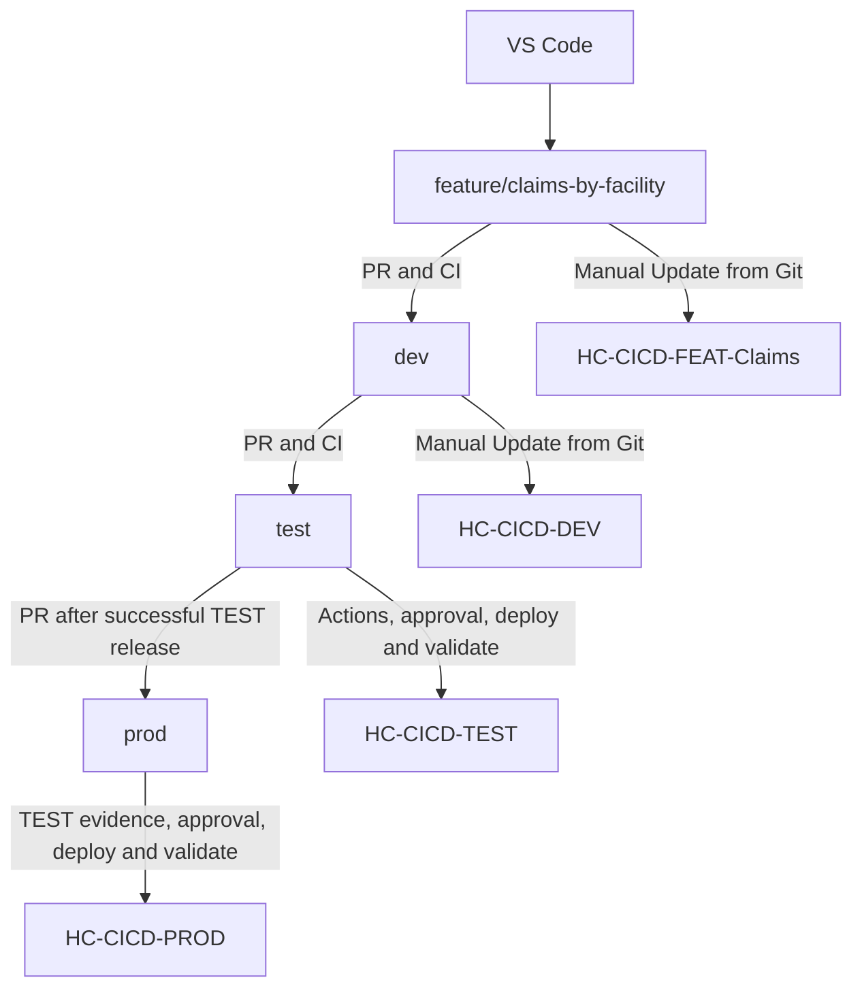

# Healthcare Git and Fabric flow

Create each short-lived feature branch from the current `dev` branch. Pair it with a feature workspace for runtime testing before merging. Keep `dev`, `test`, and `prod` as the three permanent environment branches.

| Layer | Role |
|---|---|
| Feature branch | Isolates the proposed source change; draft PRs start CI |
| Feature workspace | Runs that feature with its own lakehouse and synthetic data; evidence is reviewed before merge |
| `dev` and DEV workspace | Integrate reviewed changes and verify the shared solution |
| `test` and TEST workspace | Run an approved automated deployment and record runtime validation evidence |
| `prod` and PROD workspace | Require matching tested content, then approval, deployment, and runtime validation |

TEST and PROD are not connected through Fabric Git integration. GitHub Actions uses `fabric-cicd` and Entra OIDC to publish their item definitions. Definition deployment does not copy lakehouse data; the lab seeds fixed fixtures separately.

The initial DEV export is a bootstrap operation. After bootstrap, business changes enter `dev` through PRs. Feature and DEV synchronization and feature runtime-evidence review remain manual in this lab; the workflows do not automatically provision feature workspaces or enforce that manual evidence gate.

Each workspace has its own `healthcare_lakehouse`. In this edition, code is authored in VS Code and source notebook metadata keeps canonical DEV IDs. Feature-only lakehouse attachments stay local to the feature workspace. Follow Module 6's binding checks before running notebooks, and do not commit feature workspace IDs back into the release source.

The architecture is documented and locally checked; actual feature Git synchronization, lakehouse bindings, and Spark execution must be verified in your tenant. See [the lab guide](LAB_GUIDE.md) and [validation record](VALIDATION.md).

References: [Microsoft Fabric CI/CD best practices](https://learn.microsoft.com/en-us/fabric/fundamentals/understand-best-practices-fabric-cicd), [branched workspaces](https://learn.microsoft.com/en-us/fabric/cicd/git-integration/branched-workspace), and [notebook source control](https://learn.microsoft.com/en-us/fabric/data-engineering/notebook-source-control-deployment).
