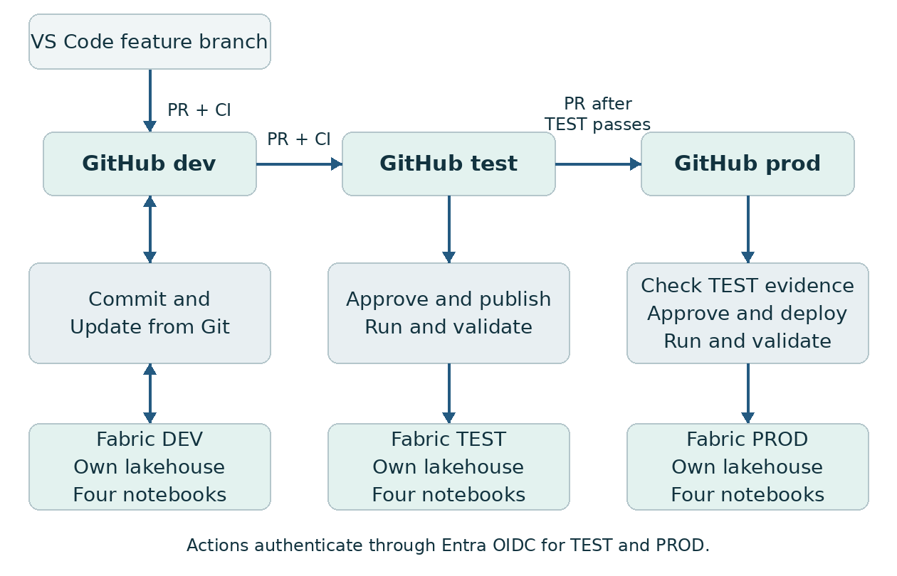

# Fabric CI CD with GitHub and VS Code

## A practical lab for Taisha Ferguson

Build and rehearse a HealthFirst analytics release using GitHub Actions, VS Code, Microsoft Entra workload identity federation, and the fabric-cicd Python package. The finished core lab promotes a claims analysis from DEV through TEST into a dedicated PROD demonstration workspace. It checks the deployed connections, runs the notebooks, validates the data, and preserves release evidence.

This guide translates the release pattern in the Microsoft Learn Azure DevOps tutorial into GitHub. Best-practice explanations distinguish choices made for a personal lab from controls to discuss with customers. Complete the modules in order and stop at each checkpoint before progressing. The estimates are planning allowances, not measured execution times; allow a few working sessions for the first build.

**Readiness:** The companion package includes locally checked code and configuration. Live GitHub OIDC authentication, Fabric item publication, Spark execution, and tenant-specific permissions must pass the checkpoints in your environment before the lab is customer-ready. See `docs/VALIDATION.md` for the exact verification record.

**Core scope:** One schema-enabled lakehouse and four notebooks in each of three workspaces. All seven CSVs enter Bronze. Patients, encounters, and claims enter Silver. Gold contains a claims-denial summary. The other four Bronze datasets remain available for future exercises. The core runs notebooks sequentially through the Fabric API; Module 9 adds a Data Pipeline and outlines the reporting extension.

| Module | Outcome | Planning allowance |
|---|---|---|
| 0 | Confirm access and GitHub approval capabilities | 20 to 40 minutes |
| 1 | Prepare VS Code and the GitHub repository | 25 to 40 minutes |
| 2 | Build and validate the DEV baseline | 45 to 75 minutes |
| 3 | Export Fabric definitions and parameterize targets | 20 to 40 minutes |
| 4 | Configure OIDC and environment approvals | 30 to 60 minutes |
| 5 | Deploy and execute the first TEST release | 30 to 60 minutes |
| 6 | Make a business change in VS Code | 20 to 40 minutes |
| 7 | Promote the tested release to PROD | 20 to 40 minutes |
| 8 | Demonstrate failure and recovery | 30 to 45 minutes |
| 9 | Extend orchestration and reporting | After the core passes |

## Architecture and release boundaries



DEV connects to the `dev` Git branch and the `fabric` folder. Fabric's Commit to Git exports item definitions. Update from Git imports reviewed source changes. VS Code edits a local clone. GitHub Actions publishes TEST and PROD using the branch content and environment-specific replacements. TEST and PROD remain disconnected from Fabric Git integration in this design. [S01, S03, S04]

The deployment identity uses OIDC to authenticate to Entra. Fabric Git integration uses its own GitHub personal access token. Your interactive Azure CLI login is a third, local-development identity. Keeping these three paths explicit makes authentication problems easier to diagnose. [S03, S06, S07]

Data remains in each environment. Deploying a lakehouse definition does not transfer its files or table contents. This lab seeds identical synthetic fixtures, then rebuilds its demonstration tables. Customers should design their own environment-specific ingestion and data retention processes. [S05]

| Azure DevOps concept | GitHub lab implementation |
|---|---|
| Azure Repos | GitHub repository and protected promotion branches |
| Azure Pipelines agent and YAML | GitHub-hosted runner and workflow files |
| Variable groups | GitHub environment variables and versioned lab configuration |
| ADO Environment approval | GitHub Environment deployment approval |
| Client secret in Key Vault | Entra federated identity credential using GitHub OIDC |
| Python deployment task | `python -m scripts.deploy` with fabric-cicd |
| GUID substitution | Generated `fabric/parameter.yml` |

**Customer explanation:** Git records the intended version of the solution. The workflow records which version was deployed, where it ran, and whether the checks passed. A successful publication alone does not demonstrate that the workload can execute.

## Module 0 Confirm prerequisites

### Choose the lab boundaries

1. Use a new repository named `fabric-healthfirst-cicd` and new workspaces named `HF-CICD-DEV`, `HF-CICD-TEST`, and `HF-CICD-PROD`. Reuse the healthcare scenario from your MCP lab while keeping these release experiments in their own workspaces.
2. Confirm that your Fabric capacity is active and can run Spark notebooks. Your previously used `taishafabric F8` is a candidate if still available. Start with one run at a time and measure capacity behavior. This lab does not require Copilot, an LLM endpoint, or the full hackathon workload.
3. Choose repository visibility according to your organization's policy and GitHub plan. GitHub's required environment reviewers are available for public repositories on Free, Pro, and Team plans. Private/internal approval support requires an eligible Enterprise configuration. Check the actual settings page before relying on a gate. [S08]
4. For a solo rehearsal, you can designate yourself as an environment reviewer and leave prevention of self-review off. A required pull-request review is different: you cannot approve your own PR. Use zero required PR approvals for the solo lab, or add a collaborator. Customer production controls should have independent reviewers.
5. If required deployment reviewers are unavailable, pause the gated-release portion and resolve the plan/visibility decision. A workflow Run button is not an equivalent independent approval control.

### Confirm access

| Requirement | Who or where to check |
|---|---|
| Create the three workspaces and assign capacity | Fabric workspace and capacity permissions |
| Connect DEV to GitHub | Workspace Admin, GitHub repository access, fine-grained PAT |
| Synchronize with Git and GitHub | Fabric Git integration tenant settings |
| Register Entra apps and federated credentials | Entra app-registration permission or an administrator |
| Call Fabric APIs as the deployment identities | Fabric tenant developer setting and permitted security group |
| Upload fixtures from VS Code and Actions | OneLake external-app access setting and workspace permissions |
| Run GitHub Actions | Repository Actions policy permits the pinned official actions |

The current developer-settings documentation calls the relevant toggle **Service principals can call Fabric public APIs**; other Fabric pages/UI versions may say **Service principals can use Fabric APIs**. Scope it to the deployment identities through an approved security group. Workspace creation automation has a separate setting; this lab creates workspaces manually. [S09]

OneLake uploads also require **Users can access data stored in OneLake with apps external to Fabric** to be permitted for the identities in use. [S10]

**Best practice discussion:** Microsoft recommends isolating production capacity from development/testing and provisioning resources repeatably. Sharing one capacity and creating three workspaces manually keeps this personal lab small. Workspace isolation separates content and permissions, while capacity isolation separates compute contention. A customer implementation should choose both deliberately. [S02]

**Checkpoint 0:** Record the tenant ID, capacity name, GitHub owner/repository, repository visibility/plan, and who can configure the Fabric and Entra settings. No deployment should be enabled yet.

## Module 1 Prepare VS Code and GitHub

### Prepare the local project

1. Extract the companion ZIP into a new folder, for example `C:\Users\taferguson\fabric-healthfirst-cicd`. Open the folder containing `README.md` in VS Code.
2. Install or verify Git, Python 3.12, Azure CLI, and VS Code. The suggested Python, Jupyter, GitHub Pull Requests, and YAML extensions are listed in `.vscode/extensions.json`.
3. Open a PowerShell terminal in VS Code. These commands use the virtual environment's Python directly, so PowerShell activation-policy changes are unnecessary.

```powershell
git --version
py -3.12 --version
az version
py -3.12 -m venv .venv
.\.venv\Scripts\python.exe -m pip install -r requirements.txt
.\.venv\Scripts\python.exe -m scripts.validate_repo --allow-bootstrap
.\.venv\Scripts\python.exe -m pytest -q
.\.venv\Scripts\python.exe -m scripts.fetch_sample_data
```

4. In VS Code, run **Python Select Interpreter** and select `.venv`. On macOS/Linux, use `python3.12 -m venv .venv` and `.venv/bin/python` for the equivalent commands.
5. Verify that all seven file hashes and row counts pass. The downloader pins upstream commit `a84b0ff81d27c5da3b1fb8aac5641cd5507a78ac`. It does not regenerate the sample data. Keep `data/` untracked; `.gitignore` already excludes it.

### Initialize the repository

1. Create an empty GitHub repository with the agreed visibility. Do not initialize a second README or license there. Copy its HTTPS clone URL.
2. Run the following, replacing the URL with your repository. Review `git status` before the commit.

```powershell
git init -b dev
git add .
git status
git commit -m "Initialize HealthFirst CI CD lab"
git remote add origin https://github.com/OWNER/fabric-healthfirst-cicd.git
git push -u origin dev
git branch test
git branch prod
git push origin test prod
```

3. In GitHub Settings, confirm `dev` is the default branch. Keep **Allow merge commits** enabled. This lab uses **Create a merge commit** for promotions, especially TEST to PROD; do not use squash or rebase for those promotions.
4. Under Settings, Secrets and variables, Actions, create the repository variable `LAB_READY` with value `false`. When the variable is absent or false, deployment jobs are skipped. The initial pushes to TEST and PROD therefore perform no deployment.
5. Under Settings, Actions, General, allow the official actions used by the workflows, subject to organization policy. Keep the default token read-only. Individual deployment jobs request only the permissions they need.

**Best practice discussion:** Pinning the package versions and action commit SHAs limits changes between rehearsals. Review dependency updates in a separate change and repeat the checks. The lock file captures versions, not package-file hashes; production teams can add hash verification and their approved package supply-chain controls.

**Checkpoint 1:** The CI workflow is green, the three branches exist, and no Fabric release has run. A bootstrap-success message means the local package is healthy; it does not mean Fabric definitions exist yet.

## Module 2 Build the DEV baseline

### Create the environment containers

1. In Fabric, create `HF-CICD-DEV`, `HF-CICD-TEST`, and `HF-CICD-PROD`. Assign each to the chosen active capacity.
2. In each workspace, create a **schema-enabled** lakehouse named exactly `healthcare_lakehouse`. Keep the same display name across environments. The notebooks explicitly use the `dbo` schema.
3. Wait for each SQL analytics endpoint to finish provisioning. Record each workspace ID and lakehouse item ID from its URL/item details. Use the lakehouse ID, not the SQL endpoint ID.
4. Copy `lab-config.example.json` to `lab-config.json`. Enter the six real GUIDs under the corresponding environment. Workspace IDs and lakehouse IDs must all be different across stages. Keep `items_in_scope` and `notebook_order` unchanged for the core lab.

The target lakehouses are provisioned before the first release so their IDs are known. The release still includes their metadata in scope. This makes the initial mapping exercise deterministic and avoids depending on dynamically generated IDs during the first deployment.

### Import and attach the notebooks

1. In the DEV workspace, import all four notebooks from `bootstrap/`: `HF01_Bronze.ipynb`, `HF02_Silver.ipynb`, `HF03_Gold.ipynb`, and `HF04_Validate.ipynb`.
2. Confirm the display names are exactly `HF01_Bronze`, `HF02_Silver`, `HF03_Gold`, and `HF04_Validate`. Remove accidental filename suffixes if the import UI adds them.
3. Open each notebook. Add DEV's `healthcare_lakehouse` and set it as the default lakehouse. Use the normal PySpark runtime; this core lab needs no custom Environment item or package installation inside Spark.
4. Save each notebook. If a Spark session was already running before you changed the default lakehouse, stop it and start a new session.

### Load the fixed fixtures and run DEV

```powershell
az login --tenant YOUR_TENANT_ID --allow-no-subscriptions
.\.venv\Scripts\python.exe -m scripts.seed_data --environment dev
```

The upload writes only the seven fixture files plus `sample-manifest.json` under `Files/raw/cicd_lab` in the configured lakehouse. Re-running it replaces those lab files with the same verified bytes. It does not copy tables between workspaces.

Run the notebooks from the Fabric UI in numeric order. Wait for each to finish before starting the next. Bronze checks file hashes and CSV parsing before writing seven tables. Silver checks unique IDs and relationships before creating three typed tables. Gold produces the payer-level summary. Validate independently calculates expected values from the raw CSVs and compares every Gold group with the Spark result.

| Fixture | Expected rows |
|---|---:|
| Patients | 200 |
| Encounters | 1025 |
| Conditions | 428 |
| Claims | 1025 |
| Vitals | 4299 |
| Medications | 643 |
| Clinical notes | 150 |

**Expected baseline:** 7 Bronze tables, 3 Silver tables, and `dbo.gold_claims_denial` with 10 payer groups. Summed claim counts equal 1025. The pinned fixture has 40 claims with status `Denied`. These are fixture checks, not industry benchmark rates. Conditions have blank encounter references in this fixture; the core Silver relationship tests deliberately apply to patients, encounters, and claims.

**Customer explanation:** Fixing the test data lets us distinguish a code change from a change in the input. Our runtime validation uses an independent calculation, so an incorrect denominator in the Spark aggregation produces a failed release.

**Checkpoint 2:** All four DEV notebooks complete, the validation notebook prints `validation: passed`, and the expected counts match. Resolve failures here before introducing deployment automation.

## Module 3 Connect Fabric Git and parameterize targets

### Export the working solution

1. Create a GitHub fine-grained PAT restricted to this repository with Contents read/write, and complete any organization approval or SSO authorization required. Keep the token out of files and chat. [S03]
2. In DEV Workspace settings, Git integration, choose GitHub. Add the account/token, choose your repository, branch `dev`, and folder `fabric`.
3. Connect and sync. The target folder is initially empty, so export the DEV workspace content to Git. If a direction choice appears, confirm that you are preserving the working DEV items and writing them into the intended empty folder.
4. Confirm all five items show Synced. In GitHub, inspect `fabric/healthcare_lakehouse.Lakehouse` and the four `.Notebook` folders. Each should have a `.platform` file. Each notebook should have `notebook-content.py`. [S04]
5. Return to VS Code and pull the Fabric commit. The imported bootstrap notebooks are now historical setup inputs; future release edits belong in the generated `fabric/` source.

```powershell
git switch dev
git pull --ff-only origin dev
.\.venv\Scripts\python.exe -m scripts.prepare_parameters
.\.venv\Scripts\python.exe -m scripts.validate_repo
git add lab-config.json fabric/parameter.yml
git commit -m "Configure environment mappings"
git push origin dev
```

### Review the configuration

Open `fabric/parameter.yml`. The first rule replaces the DEV workspace GUID with the TEST or PROD workspace GUID. The second replaces the DEV lakehouse GUID with its corresponding target. The environment keys are exactly lowercase `test` and `prod`, matching the deployment script arguments. The generator reads `lab-config.json`; re-run it whenever any environment ID changes. [S06]

Open a notebook's generated Python file. Locate its metadata for `default_lakehouse` and `default_lakehouse_workspace_id`. Keep the DEV values in the repository. The deployment package applies the target substitutions while publishing; it does not commit TEST or PROD IDs into the notebook source.

Do not recreate logical IDs or hand-author `.platform` files. Those files establish item identity. Do not add sample CSVs or workflow scripts inside `fabric/`. The deployment directory should contain Fabric item definitions and `parameter.yml`. [S04, S06]

**Customer explanation:** A connection is part of a release's behavior. The same code can write to the wrong environment if its references are wrong. The lab checks the published notebook bindings before uploading or executing the target workload.

**Checkpoint 3:** `scripts.validate_repo` passes without `--allow-bootstrap`. It finds the required items, unique logical IDs, DEV notebook attachments, and parameter rules consistent with the environment inventory.

## Module 4 Configure identities and approvals

### Create the deployment identities

Use two Entra app registrations for the full lab: `hf-cicd-test` and `hf-cicd-prod`. Each identity has access only to its target workspace. If your administrator provides an existing approved identity, document its broader access as a lab exception.

1. In Entra App registrations, create a single-tenant app. Record its Application client ID and Directory tenant ID. No redirect URI is needed for this workload.
2. Open Certificates and secrets, Federated credentials, Add credential. Select the GitHub Actions scenario. Enter the exact GitHub owner and repository. Select entity type **Environment** and enter `test` for the TEST app.
3. Confirm the issuer is `https://token.actions.githubusercontent.com`, the audience is `api://AzureADTokenExchange`, and the subject is `repo:OWNER/REPO:environment:test`.
4. Repeat for the PROD app with subject `repo:OWNER/REPO:environment:prod`. Repository and environment names must match the workflow context exactly. A branch-subject credential does not match a job that uses an environment. [S07]
5. Add each service principal to the security group permitted by the Fabric API tenant setting. In Fabric workspace access, grant the TEST app **Member** in TEST and the PROD app **Member** in PROD. Member matches the tutorial's starting permission; evaluate whether Contributor meets the chosen item operations before adopting it as a production minimum.
6. Do not grant Azure subscription Contributor merely to deploy Fabric items. This lab uses `allow-no-subscriptions: true` and Fabric/OneLake permissions. Additional Azure operations would require their own authorization. [S07, S11]

### Create GitHub Environments

Under repository Settings, Environments, create lowercase `test` and `prod`. For each, add the following environment variables, using the appropriate app and workspace:

| Variable | Value |
|---|---|
| `AZURE_TENANT_ID` | Entra Directory tenant ID |
| `AZURE_CLIENT_ID` | This environment's app registration client ID |
| `FABRIC_WORKSPACE_ID` | This environment's workspace ID from `lab-config.json` |

Configure required reviewers and deployment branch restrictions. The `test` environment allows only the `test` branch; `prod` allows only `prod`. For the solo run, allow self-review of deployments. In a customer production process, use independent reviewers and prevent self-review and bypass where supported. Environment variables are configuration, not client secrets. [S08]

### Configure branch rules

Protect `test` and `prod`: require a pull request, require the **Validate repository** check once it has appeared, block force pushes and branch deletion, and restrict bypass according to your plan. Do not require linear history, since this lab intentionally uses merge commits. A solo lab can require PRs without requiring a second person's approval. Inspect the effective rules; an unavailable setting is not enforced just because it is described here.

After the initial Fabric export, apply the same PR discipline to `dev`. Future VS Code edits use feature branches. Fabric edits can be committed to a standalone feature branch and merged through a PR. DEV then uses Update from Git to import the reviewed result. Dedicated feature workspaces are the scalable team extension; the solo core keeps one DEV workspace. [S02, S03]

**Checkpoint 4:** Both Entra subjects, environment variables, branch restrictions, and reviewers are configured. Set repository variable `LAB_READY` to `true` only now. Setting it does not itself start a release; the next TEST/PROD push does.

## Module 5 Deploy and validate TEST

1. In GitHub, open a PR with base `test` and compare `dev`. Review the exported definitions, mappings, scripts, and workflow diff.
2. Wait for **Validate repository** to pass. Select **Create a merge commit** and merge. This pushes a new commit to `test`, triggering **Deploy TEST**.
3. Open Actions, Deploy TEST. Review the commit and target environment, then approve the pending `test` deployment.
4. Observe the steps: install pinned dependencies; validate the repository and run local tests; authenticate with OIDC; publish the scoped definitions; audit notebook bindings; seed verified data; execute Bronze, Silver, Gold, and Validate sequentially.
5. Wait for actual notebook completion. An HTTP 202 response means a job was accepted. The script follows the Location header, honors Retry-After, and polls for Completed. Failed or canceled jobs fail the workflow. [S12, S13]
6. Download the `test-validation-COMMIT_SHA` artifact. Its receipt records the commit, target workspace/lakehouse, notebook item IDs, job IDs, completion time, and result. It is created only after all four notebooks succeed.
7. In Fabric TEST, confirm the five deployed items, inspect a notebook's lakehouse attachment, and inspect `dbo.gold_claims_denial`. It should have 10 groups and total 1025 claims. Confirm DEV remains a separate workspace with its own lakehouse ID.

The deployment covers all in-scope Lakehouse and Notebook definitions, even if only one notebook changed. There is no changed-item-only optimization and no automatic orphan deletion. Renames/deletions therefore need explicit handling in a later extension. TEST and PROD workflows have separate concurrency groups and do not cancel an active deployment when another commit arrives. GitHub can replace an older pending run when multiple runs queue, so promote one release at a time during the lab.

**Customer explanation:** Approval authorizes a release, while runtime validation supplies evidence that it works. The deployment uses a nonhuman identity and records the source version, so the process does not depend on my VS Code session remaining signed in.

**Checkpoint 5:** Both the workflow and all four Fabric jobs are successful. A successful local login or successful item publication does not satisfy this checkpoint.

## Module 6 Make a business change in VS Code

### Add facility detail

```powershell
git switch dev
git pull --ff-only origin dev
git switch -c feature/claims-by-facility
```

1. Open `fabric/HF03_Gold.Notebook/notebook-content.py`. If Fabric used a different folder name, locate the item by its `.platform` displayName. Change only `GROUP_BY_FACILITY = False` to `GROUP_BY_FACILITY = True`.
2. Explain the business change: the existing payer summary now separates each payer by facility, enabling comparisons across the three synthetic hospitals.
3. Run the local checks and inspect the diff. The validation notebook already supports both grains and calculates the expected results independently.

```powershell
.\.venv\Scripts\python.exe -m scripts.validate_repo
.\.venv\Scripts\python.exe -m pytest -q
git diff
git add fabric
git commit -m "Break down claims denials by facility"
git push -u origin feature/claims-by-facility
```

4. Open a feature-to-`dev` PR. Review the one-line business change and successful CI checks, then merge. Pull `dev` locally.
5. In the DEV workspace Source control pane, use **Update from Git**. Run Gold and Validate to inspect the new output. Confirm 30 payer/facility groups and the same total 1025 claims. This manual DEV sync is an intentional lab step; Git pushes do not automatically update the live workspace.
6. Open and merge a `dev`-to-`test` PR. Approve the TEST deployment and wait for its new validation receipt. Confirm TEST now has 30 groups. Record the successful TEST run URL and commit SHA.
7. Delete the completed feature branch after the PR is merged, leaving the environment branches intact.

**Customer explanation:** The PR exposes exactly what changed in the business logic. The result has finer detail, while the total number of claims stays constant. Testing that invariant helps detect join multiplication and accidental filtering.

**Checkpoint 6:** DEV and TEST show the new grouping, and the exact latest TEST release has a successful workflow and receipt. Do not edit TEST items manually to make the checks pass.

## Module 7 Promote the tested version to PROD

1. Open a PR with base `prod` and compare `test`. Review the changes and link the successful TEST run in the PR description. Use **Create a merge commit** when merging.
2. Open the **Deploy PROD** workflow. Its first job, **Require tested release**, has no Fabric login. It checks that the PROD commit is a two-parent merge, that its entire repository tree equals the second parent's tree, and that this source commit has a successful TEST deployment job plus a nonexpired validation artifact. [S14]
3. The merge commit's SHA will differ from the TEST commit SHA. The guard compares their tree IDs, which represent the content. A production-only conflict resolution, direct push, squash merge, or rebase does not meet this lab's promotion contract.
4. After that guard passes, approve the pending PROD environment deployment. Review the TEST evidence and target workspace before approval.
5. Wait for publication, binding audit, seeding, and all four runtime jobs. Confirm PROD has 30 Gold groups and its own lakehouse attachment. Download the production receipt.

The guard relies on GitHub workflow results and artifact presence. Protect the workflows, scripts, configuration, and branch rules from unreviewed changes. A repository administrator can change those controls; this lab is not a cryptographic supply-chain attestation system. Artifacts are retained for 30 days. If TEST evidence has expired, rerun the corresponding TEST workflow before promotion.

**Customer explanation:** We verify the content that passed TEST before allowing PROD credentials to be used. The same source definitions are deployed with reviewed environment substitutions. Environment-specific configuration is expected to differ; business logic is expected to match.

**Checkpoint 7:** The production guard, approval, deployment, and runtime validation all pass. Save both run URLs and receipts in your rehearsal record.

## Module 8 Demonstrate failure and recovery

### Show a CI failure

Create a new feature branch from current `dev`. Introduce a Python syntax error in Gold, commit, and open a PR to `dev`. The **Validate repository** check should fail before any deployment. Show the failure, fix the syntax, and verify the check passes. Close the exercise PR if it contains no intended business change.

### Show a runtime data failure

1. Create `feature/denial-regression` from current `dev`. In Gold, change the rate multiplier from `100.0` to `1000.0`. The code remains syntactically valid, so local CI is not expected to catch this business defect.
2. Merge through DEV and TEST. Approve the TEST deployment and observe that HF04_Validate fails when the computed rate differs from the independent raw-data calculation.
3. Show the failed Fabric job and GitHub run. No successful validation receipt is produced for that commit. Avoid merging this version into PROD during normal use; the production guard would reject it because it lacks successful TEST evidence.
4. Restore `100.0` on a new feature branch from current `dev`, review the diff, merge through DEV and TEST, and obtain a new successful TEST run. Only then promote to PROD.

### Practice a code rollback

To undo the facility grouping, identify the original commit that changed the Boolean flag. Create a new branch from current `dev` and revert that single feature commit, then review and promote the result through TEST and PROD. Reverting a merge commit requires a mainline choice; use the original single-change commit for this exercise.

```powershell
git switch dev
git pull --ff-only origin dev
git switch -c rollback/payer-summary
git revert ORIGINAL_FEATURE_COMMIT_SHA
git push -u origin rollback/payer-summary
```

After the reviewed rollback runs, expect 10 Gold groups and the same 1025 total claims. Reapply the facility change through a new feature PR if you want the customer demo to finish at the more detailed version.

**Customer explanation:** A code rollback restores a previous definition. It does not automatically restore deleted data or reverse every schema migration. This lab can rebuild its tables from fixed fixtures because it uses small, replaceable demonstration data. Production recovery needs retention, backup, schema-compatibility, and migration decisions appropriate to the workload.

**Checkpoint 8:** You can explain and demonstrate a CI failure, a runtime failure, successful recovery, and a tested code rollback without editing TEST or PROD directly.

## Module 9 Extend the lab

### Add Fabric Data Pipeline orchestration

The core release script is the single entry point for sequential notebook execution. This extension demonstrates Fabric orchestration after the core identity path works.

1. In DEV, create a Data Pipeline named `HF_Healthcare_ETL`. Add four Notebook activities in the same order as the core notebooks. Connect each activity to the next using the success dependency, so validation cannot run ahead of Gold.
2. Select the notebook in the current workspace for every activity. If the activity requires a Fabric connection, create or select the approved connection and record how its identity will work in TEST and PROD.
3. Run the pipeline in DEV and confirm all four activities succeed. A deployment identity and a workload connection identity may have different permissions; inspect both.
4. Commit the pipeline to a feature branch using Fabric source control and merge into `dev`. Add `DataPipeline` to `items_in_scope` in `lab-config.json` through the same reviewed change. Keep the core notebook order unchanged.
5. Inspect `pipeline-content.json` for workspace, notebook, and connection references. The package handles supported item references, while connection objects must be provisioned separately and their IDs parameterized. Update `parameter.yml` and its generator/check deliberately if adding new rules; the initial checker intentionally rejects unexpected mappings. [S06, S15]
6. Deploy to TEST. Before running, open the target pipeline and verify each activity targets the TEST notebook and appropriate connection. Run it in the UI first, then use `python -m scripts.run_pipeline --environment test` to prove unattended execution.
7. The included pipeline runner audits the four notebook bindings and checks that the pipeline's definition mentions the four target notebook IDs. It rejects embedded IDs belonging to the other configured environments. It waits for the pipeline to complete and then runs HF04_Validate independently. An unresolved or logical-only reference fails closed for manual inspection rather than guessing.
8. Once this extension is verified, change the release workflows to call the pipeline runner instead of the notebook runner. Make that workflow change in DEV, test it, and promote it. Run exactly one orchestration path per release.

This extension needs live verification of pipeline reference format and connection behavior. A pipeline created or modified by an SPN can have that SPN as its last-modified identity, but that does not automatically grant access to every referenced data source. [S15]

### Add a semantic model and report

Create a small model and report over `gold_claims_denial` after the core release is stable. A useful page shows claim count, denied claim count, denial rate, payer, and facility. Treat the model and report as an additional release scope: capture their definitions, parameterize the target lakehouse or SQL endpoint, provision the target connection, validate binding and model access, and test the report after deployment. Confirm Direct Lake/Import mode and permissions explicitly. [S16]

The starter validator deliberately allows only Lakehouse, Notebook, and optional DataPipeline items. Adding SemanticModel/Report requires extending that allowlist, defining model-specific checks, and updating deployment scope. This is an extension exercise, not a claim that the core package already deploys a complete Power BI solution.

### Scale toward a customer implementation

Discuss separate production capacity, dedicated feature workspaces, variable libraries for supported runtime settings, environment-specific connections, repeatable provisioning with Terraform or APIs, and independently reviewed releases. Select these controls according to the customer's workload and operating model. [S02]

For higher release volume, consider a shared release tag or immutable artifact promoted through stages. This lab intentionally keeps per-environment branches to stay close to the source tutorial. The branch model is a teaching choice, not a universal requirement.

## Customer demonstration and explanations

### Suggested demonstration sequence

| Segment | Show | Explain |
|---|---|---|
| Architecture | Diagram and three workspaces | Source control, deployment, and data execution are separate responsibilities |
| Source change | Gold notebook diff in VS Code | The business change is one reviewed source change |
| CI | Pull-request checks | Cheap checks run before cloud credentials are used |
| TEST | Workflow, target bindings, notebook jobs | Published definitions must also execute correctly |
| Approval | PROD guard and environment approval | Review combines technical evidence with human authorization |
| Result | 30-group Gold output | The release adds facility detail while preserving claim totals |
| Recovery | Saved failed run and reverted change | Failure is visible and recovery follows the same release process |

Reserve roughly 15 to 20 minutes for the presentation, but rehearse actual Spark startup and execution times first. Keep a completed successful run and a completed failed run available, so a customer meeting can inspect evidence while a live run is pending. Do not describe a saved run as a live execution.

### Explain the lab tradeoffs

| Lab choice | Reason in this lab | Customer production consideration |
|---|---|---|
| One shared capacity | Reduce setup and cost | Isolate production capacity and monitor concurrency |
| Manual workspace/lakehouse setup | Make IDs and boundaries visible | Provision repeatably with reviewed IaC or setup automation |
| One shared DEV workspace | Keep the solo exercise small | Use dedicated feature workspaces for concurrent development |
| Self-approved deployment | Allow one person to rehearse | Independent release approval and controlled bypass |
| Static target GUID mapping | Teach the tutorial's substitution model | Evaluate dynamic references and variable libraries by item support |
| Full lab-scope publication | Keep desired content predictable | Add selective deployment only with dependency-aware tests |
| Overwrite demonstration tables | Make fixture reruns reproducible | Use deliberate data migrations, retention, and recovery controls |
| No orphan deletion | Avoid accidental lab-item removal | Define and review deletion and rename handling explicitly |

## Troubleshooting and recovery checks

| Symptom | Likely check or action |
|---|---|
| Deployment is skipped | Confirm repository variable `LAB_READY` equals lowercase `true` |
| No environment approval controls | Check GitHub plan and repository visibility before proceeding |
| OIDC reports no matching federated credential | Compare issuer, audience, owner/repo, environment name, and exact subject |
| Fabric API returns 401 or 403 | Check tenant, allowed SPN group, target workspace role, and item/API identity support |
| Upload gets 403 but item deployment works | Check OneLake external-app setting and the same identity's data access |
| Target lakehouse not found | Confirm name, workspace ID, lakehouse item ID, and schema-enabled setup |
| Notebook missing default lakehouse metadata | Attach the DEV lakehouse as default, save, and commit from Fabric again |
| Binding audit fails | Stop before execution; correct mapping/source metadata and redeploy |
| Spark cannot resolve dbo tables | Confirm schema-enabled lakehouse, default attachment, session restart, and notebook order |
| CSV checksum fails | Keep the pinned commit; remove only the affected local downloaded fixture and redownload |
| Runtime validation fails | Inspect the failed notebook and actual group totals; do not weaken the test to force a green run |
| PROD rejects a squash or direct commit | Restore promotion discipline through a reviewed merge; do not bypass the guard |
| PROD cannot find TEST evidence | Check the exact source commit, successful deploy job, and artifact retention |
| Job exceeds timeout | Inspect the live Fabric job before retrying; a runner timeout may leave a job active |
| Many queued releases | Pause new merges and finish one rehearsal release at a time |

Job starts are not automatically replayed after ambiguous transport failures, because the first request may already have started a job. Inspect Fabric monitoring before retrying. Deployment is not an atomic transaction across all items; a failure can leave a partial update. Correct the cause and rerun the same intended release, then inspect the target again.

### Cleanup after the lab

Set `LAB_READY` to `false`, stop active jobs, and remove any demo schedules you added. Delete the dedicated lab workspaces only when you no longer need their data or history. Remove their app role assignments and federated credentials when retiring the lab. Revoke the GitHub PAT when it is no longer needed. Pause a capacity only if you own it and no other workloads need it.

## Rehearsal record

| Evidence | Record during your build |
|---|---|
| Tenant and capacity | |
| Repository and visibility/plan | |
| DEV workspace and lakehouse IDs | |
| TEST workspace and lakehouse IDs | |
| PROD workspace and lakehouse IDs | |
| TEST and PROD deployment client IDs | |
| Successful TEST run URL and source commit | |
| Successful PROD run URL and merge commit | |
| Failed CI and failed runtime run URLs | |
| Rollback result and elapsed execution times | |
| Remaining tenant-specific issues | |

## References

Use these primary sources when explaining platform behavior. The scripts, exercises, guard design, and customer explanations are original lab implementations. Documentation and item support can change; revisit these sources when upgrading the pinned package or broadening the scope.

- **S01** [Microsoft Learn Azure DevOps and fabric-cicd tutorial](https://learn.microsoft.com/en-us/fabric/cicd/tutorial-fabric-cicd-azure-devops)
- **S02** [Microsoft Learn Fabric CI CD concepts and best practices](https://learn.microsoft.com/en-us/fabric/fundamentals/understand-best-practices-fabric-cicd)
- **S03** [Fabric Git integration setup](https://learn.microsoft.com/en-us/fabric/cicd/git-integration/git-get-started)
- **S04** [Notebook source control and deployment](https://learn.microsoft.com/en-us/fabric/data-engineering/notebook-source-control-deployment)
- **S05** [Lakehouse Git integration and deployment behavior](https://learn.microsoft.com/en-us/fabric/data-engineering/lakehouse-git-deployment-pipelines)
- **S06** [fabric-cicd parameterization](https://microsoft.github.io/fabric-cicd/1.4.0/how_to/parameterization/) and [authentication](https://microsoft.github.io/fabric-cicd/1.4.0/example/authentication/)
- **S07** [GitHub OIDC with Azure](https://docs.github.com/en/actions/how-tos/secure-your-work/security-harden-deployments/oidc-in-azure)
- **S08** [GitHub deployment environments and protection rules](https://docs.github.com/en/actions/how-tos/deploy/configure-and-manage-deployments/manage-environments)
- **S09** [Fabric developer tenant settings](https://learn.microsoft.com/en-us/fabric/admin/service-admin-portal-developer)
- **S10** [OneLake security and external application access](https://learn.microsoft.com/en-us/fabric/onelake/security/fabric-onelake-security) and [Python access](https://learn.microsoft.com/en-us/fabric/onelake/onelake-access-python)
- **S11** [Azure Login action](https://github.com/Azure/login)
- **S12** [Run a notebook on demand](https://learn.microsoft.com/en-us/rest/api/fabric/notebook/background-jobs/run-on-demand-notebook)
- **S13** [Get Fabric job status](https://learn.microsoft.com/en-us/rest/api/fabric/core/job-scheduler/get-item-job-instance)
- **S14** [GitHub workflow run REST API](https://docs.github.com/en/rest/actions/workflow-runs)
- **S15** [Fabric Data Factory REST capabilities](https://learn.microsoft.com/en-us/fabric/data-factory/pipeline-rest-api-capabilities) and [pipeline service principal ownership](https://learn.microsoft.com/en-us/fabric/data-factory/set-pipeline-owner-tutorial)
- **S16** [fabric-cicd supported item behavior](https://microsoft.github.io/fabric-cicd/1.4.0/reference/item_types/)
- **S17** [SmartterHealth healthcare sample](https://github.com/SmartterHealth/FabricHackathon) and [pinned sample commit](https://github.com/SmartterHealth/FabricHackathon/tree/a84b0ff81d27c5da3b1fb8aac5641cd5507a78ac)

Prepared October 28 2026. Python 3.12 and fabric-cicd 1.4.0 are the reference toolchain for this edition.
